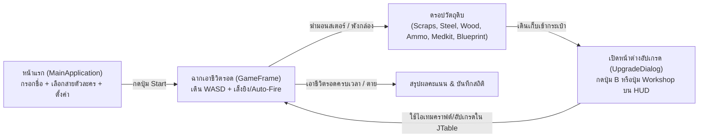
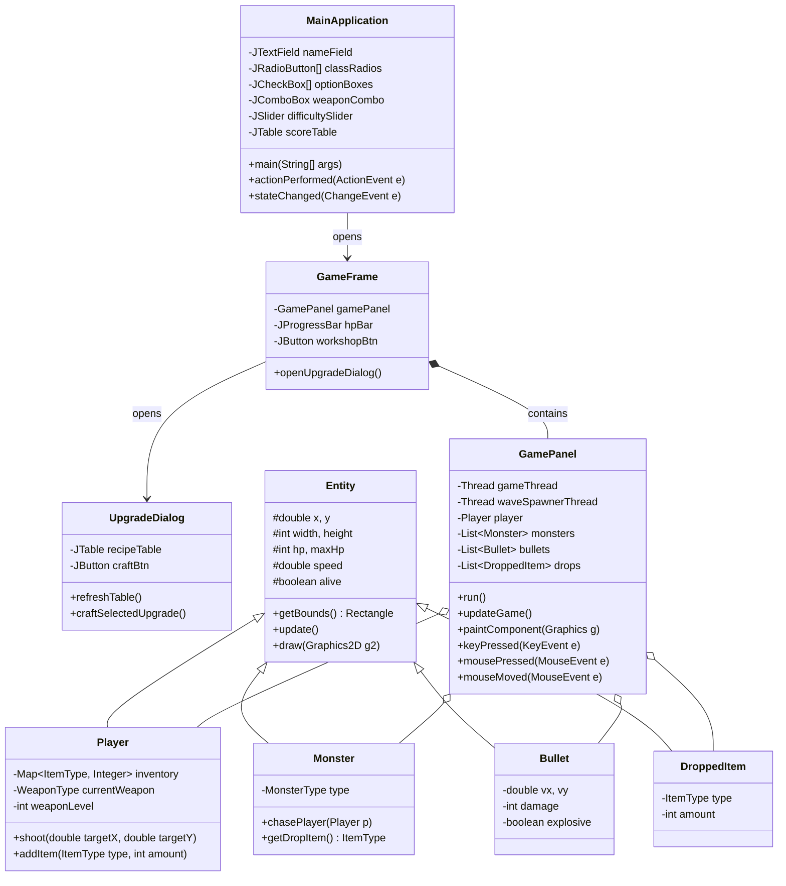

# โครงสร้างโปรเจกต์เกม: **Last Camp Survivor** (EGCO 213 – Group Project 3)

เอกสารฉบับนี้ออกแบบโครงสร้างโปรเจกต์เกม **2D Top-Down Survival (สไตล์ Vampire Survivors ผสมระบบฟาร์มไอเทมอัปเกรด)** โดยใช้ Assets จากชุด `UPDATE 2_ZombiePack` และเน้น **โครงสร้างโค้ด OOP ที่เรียบง่าย ไม่อ้อมค้อม อธิบายโค้ดตอนสอบนำเสนอได้สบาย** พร้อมผ่านเกณฑ์คะแนนครบทุกข้อ (เป้าหมายตัวคูณความยาก `D = 1.5`)

---

## 1. คอนเซปต์เกม (Core Game Loop)

> **แนวเกม**: Top-Down Arena Survival & Monster-Loot Crafting  
> **จุดเด่น**: แทนที่จะเก็บเพชร XP เพื่อสุ่มสกิลเหมือน Vampire Survivors ผู้เล่นจะต้อง **ยิงซอมบี้และโจรเพื่อดรอปชิ้นส่วน/วัตถุดิบจริง** แล้วนำวัตถุดิบมา **คราฟต์อาวุธใหม่ อัปเกรดปืน และเสริมแกร่งตัวละคร**



### กลไกการเล่นหลัก
1. **การเคลื่อนที่และต่อสู้**:
   - เดินหลบฝูงซอมบี้ด้วยปุ่ม `W, A, S, D`
   - เล็งเป้าด้วยเมาส์ (`Crosshair` หมุนปืนตามมุมเมาส์ `360°`)
   - เลือกโหมดยิงได้ 2 แบบ (ติ๊กเปลี่ยนได้จาก `JCheckBox`):
     - **Manual Shoot**: คลิกซ้ายเพื่อยิง / คลิกขวาเพื่อปาระเบิด
     - **Auto-Fire (สไตล์ Vampire Survivors)**: ปืนยิงอัตโนมัติตามจังหวะ Cooldown ไปยังทิศเมาส์หรือศัตรูที่ใกล้ที่สุด
2. **ฝูงศัตรู (Waves) และการดรอปไอเทม**:
   - ศัตรูเกิดจากขอบแผนที่เป็น Wave ต่อเนื่องตามเวลา (ยิ่งอยู่นาน ยิ่งเกิดถี่และเก่งขึ้น)
   - เมื่อศัตรูตาย จะดรอปไอเทมลงพื้นตามชนิดมอนสเตอร์ เช่น:
     - **Zombie 1 & 2 (ซอมบี้ทั่วไป)**: ดรอป `Scraps` (เศษเหล็ก), `Wood` (ไม้), `Ammo` (กระสุน), `Corn/Carrot` (อาหารเพิ่มเลือดเล็กน้อย)
     - **Zombie 3 (ซอมบี้พิษตัวเขียว)**: ดรอป `Electronics` (แผงวงจร), `Battery` (แบตเตอรี่), `Medkit` (กล่องพยาบาล)
     - **Bandit (โจรหน้ากากกันแก๊ส - ยิงสวนได้)**: ดรอป `Steel` (เหล็กกล้า), `Grenades` (ระเบิด), `ArmorVest` (เกราะ)
     - **Zombie 4 (บอสซอมบี้คลั่ง)**: ดรอป `BluePrint` (พิมพ์เขียวอาวุธขั้นสูง) และหีบสมบัติ (`GreenChest` / `RedChest`)
3. **ระบบฟาร์มของมาอัปเกรด (Crafting & Upgrade)**:
   - ผู้เล่นกดปุ่ม **`Workshop / Upgrade (B)`** เพื่อพักเกมชั่วคราวและเปิดหน้าต่าง `UpgradeDialog`
   - ในหน้าต่างจะมีตาราง `JTable` แสดงรายการอัปเกรดและจำนวนไอเทมที่ต้องใช้ เช่น:
     - **ปลดล็อก/อัปเกรดอาวุธ**: `Pistol` $\rightarrow$ `Revolver` $\rightarrow$ `Pump Shotgun` (ยิงกระจาย) $\rightarrow$ `Rifle` (ยิงรัว) $\rightarrow$ `Sniper` (ทะลุศัตรู) $\rightarrow$ `Rocket Launcher` (ระเบิด AoE)
     - **อัปเกรดสถานะตัวละคร**: เพิ่ม Max HP (`Wood + Food`), เพิ่มความเร็ววิ่ง (`Scraps + Battery`), เพิ่มเกราะลดดาเมจ (`Steel + ArmorVest`), เพิ่มแม่เหล็กดูดของ (`Electronics + Battery`)

---

## 2. การจับคู่เงื่อนไขโปรเจกต์ EGCO 213 ให้ครบ 100%

| เงื่อนไขจากเอกสาร `Project_213_T3.pdf` | การออกแบบในเกมของเรา |
| :--- | :--- |
| **ใช้ `javax.swing` เท่านั้น (ห้าม JavaFX)** | ใช้ `JFrame`, `JDialog`, `JPanel`, `Graphics2D` และ Swing Components ล้วน 100% |
| **รันบน Java 26 & ขนาดไม่เกิน `1200 x 700`** | หน้าแรกขนาด `900 x 620`, หน้าเล่นเกมขนาด `1100 x 660` (ไม่เกิน `1200 x 700` และมีระยะห่างขอบปลอดภัย) |
| **เริ่มต้นที่ `MainApplication.java`** | มีคลาส `MainApplication` ที่มี `public static void main(String[] args)` เปิดหน้าต่างแรก |
| **อย่างน้อย 2 Frames หรือ Dialogs** | มี **3 หน้าต่าง**: 1) `MainApplication` (`JFrame`), 2) `GameFrame` (`JFrame`), 3) `UpgradeDialog` (`JDialog`) |
| **1. `JTextField` / `JPasswordField` / `JTextArea`** | `JTextField` กรอกชื่อผู้เล่นในหน้าแรก + `JTextArea` แสดงวิธีเล่นและ Log การคราฟต์ไอเทม |
| **2. `JCheckBox` หรือ `JRadioButton` ($\ge$ 5 รายการ)** | - **`JRadioButton` 5 อาชีพเริ่มต้น**: *Scavenger, Soldier, Medic, Scout, Engineer*<br/>- **`JCheckBox` 5 ตัวช่วยเกม**: *Auto-Fire, Show Hitbox, Sound SFX, Background Music, Double Spawn Mode* |
| **3. `JComboBox` หรือ `JList` ($\ge$ 5 รายการ)** | **`JComboBox` เลือกอาวุธเริ่มต้น 6 ชนิด** (*Knife, Axe, Pistol, Revolver, Shotgun, Rifle*) และ **เลือกแผนที่ 5 ด่าน** |
| **4. `JButton` เปิดอีก Frame/Dialog** | ปุ่ม `"Start Survival"` ในหน้าแรกเปิด `GameFrame` และปุ่ม `"Open Workshop (B)"` ในหน้าเกมเปิด `UpgradeDialog` |
| **5. Extra Component (ไม่ได้สอนในห้อง)** | ใช้ **`JTable`** (ตารางคราฟต์/อัปเกรดไอเทม และตาราง High Score), **`JSlider`** (ปรับความดังเสียง/ความยาก), และ **`JProgressBar`** (หลอดเลือด/Wave) |
| **6. ชื่อ-รหัสสมาชิกกลุ่มทุกคน** | แสดงบน `JPanel` ส่วนท้ายของหน้าแรก + Comment หัวไฟล์ `.java` ทุกไฟล์ + ไฟล์ `readme.txt` |
| **Event Handlers $\ge$ 4 ตัว (นับตามชื่อ Method)** | มีครบ **5 Method หลัก** ที่ทำงานจริง:<br/>1. `keyPressed(KeyEvent)` — เดิน `WASD`, สลับปืน `1-6`, ใช้ยา `E`, เปิดร้าน `B`<br/>2. `mousePressed(MouseEvent)` — คลิกยิงกระสุน / ปาระเบิด<br/>3. `mouseMoved(MouseEvent)` — คำนวณมุมเมาส์หมุนปืนและเลื่อนเป้า Crosshair<br/>4. `actionPerformed(ActionEvent)` — ปุ่มเปิดหน้าต่าง, ปุ่มกดคราฟต์/อัปเกรดของ<br/>5. `stateChanged(ChangeEvent)` — เลื่อน `JSlider` ปรับระดับเสียงและความยาก |

---

## 3. โครงสร้างโฟลเดอร์และไฟล์ (Folder & Package Structure)

> [!IMPORTANT]
> ตามกฎข้อ 5.1 และ 5.2 ของเอกสารโปรเจกต์ ไฟล์ `.java` ทั้งหมดควรอยู่ในโฟลเดอร์แพ็กเกจ `Project3_XXX` (`XXX` = รหัสนักศึกษาตัวแทนกลุ่ม) โดย **ไม่ต้องแยก Sub-package ย่อย** เพื่อให้โครงสร้างตรงตามข้อกำหนดและรันบนเครื่องอาจารย์ได้ทันทีโดยไม่ติดปัญหา Path

```text
src/main/java/
└── Project3_XXX/                      <-- โฟลเดอร์หลักที่ใช้ Zip ส่งงาน (Project3_XXX.zip)
    ├── readme.txt                     <-- ชื่อ-นามสกุล (ภาษาอังกฤษ) และรหัสนักศึกษาทุกคน
    ├── demo_clip.mp4                  <-- คลิปสาธิต (< 5 นาที) บีบอัดขนาดไม่ให้ใหญ่เกิน
    │
    ├── MainApplication.java           <-- [1] คลาสหลัก (main) + หน้าต่าง Launcher ตั้งค่าก่อนเริ่มเกม
    ├── GameFrame.java                 <-- [2] หน้าต่างหลักตอนเล่นเกม (HUD บน/ล่าง + GamePanel ตรงกลาง)
    ├── GamePanel.java                 <-- [3] กระดานวาดเกม 2D + Game Loop Thread + รับ Key/Mouse Event
    ├── UpgradeDialog.java             <-- [4] หน้าต่าง JDialog สำหรับใช้ไอเทมคราฟต์/อัปเกรดอาวุธ (มี JTable)
    │
    ├── Entity.java                    <-- [5] คลาสแม่ (Superclass) ของวัตถุในเกม (x, y, hp, speed, Hitbox)
    ├── Player.java                    <-- [6] คลาสผู้เล่น (สืบทอด Entity) เก็บกระเป๋าไอเทม, เลเวลอัปเกรด, อาวุธ
    ├── Monster.java                   <-- [7] คลาสมอนสเตอร์ (สืบทอด Entity) ใช้ได้ทั้ง Zombie 1-4 และ Bandit
    ├── Bullet.java                    <-- [8] คลาสกระสุน/ระเบิด (สืบทอด Entity) คำนวณทิศทางพุ่งและดาเมจ
    ├── DroppedItem.java               <-- [9] คลาสไอเทมดรอปบนพื้น (สืบทอด Entity) มีแอนิเมชันและระบบดูดเข้าตัว
    │
    ├── GameData.java                  <-- [10] รวม Enum ข้อมูลอาวุธ, มอนสเตอร์, ไอเทม และสูตรคราฟต์ไว้ที่เดียว
    ├── AssetLoader.java               <-- [11] โหลดและตัด Sprite Sheet (.png) + เสียง (.wav) แบบปลอดภัย
    │
    └── resources/                     <-- โฟลเดอร์เก็บไฟล์ภาพและเสียง (คัดเฉพาะไฟล์ที่ใช้จริง ขนาดรวม ~2 MB)
        ├── characters/                <-- Player, Zombie 1-4, Bandit, NPC (.png)
        ├── weapons/                   <-- Weapons sprites, Bullets, Shoot animations (.png)
        ├── items/                     <-- ไอเทมดรอป 16x16 (.png)
        ├── tiles/                     <-- Wasteland, Interior, Camp tilesets (.png)
        ├── ui/                        <-- HealthBars, Buttons, Panels, Effects (.png)
        └── sounds/                    <-- ไฟล์เสียงสั้นๆ .wav (shoot.wav, hit.wav, pickup.wav, bgm.wav)
```

---

## 4. การออกแบบคลาส OOP แบบเข้าใจง่าย (Simple OOP Design)

เราใช้ **11 คลาส** ที่แบ่งหน้าที่ชัดเจน ไม่ซับซ้อน สมาชิกในกลุ่ม 5 คนสามารถแบ่งกันรับผิดชอบและอธิบายตอนนำเสนอได้ง่ายมาก:



### รายละเอียดแต่ละคลาส (ทำไมถึงไม่งงและเขียนง่าย)

1. **`GameData.java` (ศูนย์รวมข้อมูลเกมด้วย `enum`)**:
   - แทนที่จะสร้างคลาสย่อย `Zombie1.java`, `Zombie2.java`, `Pistol.java`, `Shotgun.java` แยกกันเป็นสิบๆ ไฟล์ ให้ใช้ `enum` เก็บค่าพลังไว้ในไฟล์เดียว:
     - `enum WeaponType`: เก็บชื่อปืน, ดาเมจพื้นฐาน, อัตรายิง (Cooldown), ความเร็วกระสุน, จำนวนนัดต่อการยิง (เช่น Shotgun = 5 นัดกระจาย), และรูปภาพ
     - `enum MonsterType`: เก็บชื่อ (`ZOMBIE_NORMAL`, `ZOMBIE_RUNNER`, `ZOMBIE_TOXIC`, `BANDIT_SHOOTER`, `ZOMBIE_BOSS`), เลือด, ความเร็ว, ดาเมจ และไอเทมที่ดรอป
     - `enum ItemType`: `SCRAPS`, `WOOD`, `STEEL`, `ELECTRONICS`, `BATTERY`, `BLUEPRINT`, `MEDKIT`, `AMMO`, `FOOD`
     - `class UpgradeRecipe`: เก็บชื่อสิ่งที่อัปเกรด, ไอเทมที่ต้องใช้ (เช่น `SCRAPS x5 + WOOD x3`), และผลลัพธ์เมื่อกดคราฟต์

2. **`Entity.java` (คลาสแม่สำหรับ OOP Inheritance)**:
   - เก็บพิกัด `x, y`, ขนาด `width, height`, เลือด `hp, maxHp`, ความเร็ว `speed`, สถานะ `alive`
   - มีเมธอด `public Rectangle getBounds()` เพื่อเช็กการชนกันง่ายๆ ด้วย `entityA.getBounds().intersects(entityB.getBounds())` ของ Java AWT

3. **`Player.java`, `Monster.java`, `Bullet.java`, `DroppedItem.java` (คลาสลูก)**:
   - **`Player`**: อัปเดตตำแหน่งตามปุ่ม `WASD`, เก็บจำนวนไอเทมใน `EnumMap<ItemType, Integer> inventory`, เก็บเลเวลการอัปเกรด (Damage Level, Fire Rate Level, Speed Level, Armor Level)
   - **`Monster`**: ในเมธอด `update()` แค่คำนวณมุมหันหาตัวผู้เล่นด้วย `Math.atan2(player.y - y, player.x - x)` แล้วเดินเข้าหาผู้เล่น (สำหรับ `BANDIT` สามารถยิงกระสุนสวนออกมาทุกๆ 3 วินาทีได้)
   - **`Bullet`**: เคลื่อนที่ตามความเร็ว `vx, vy` ถ้าเป็นลูกจรวด (`RocketLauncher`) เมื่อชนศัตรูจะสร้างวงระเบิด (`explosion sprite sheet (48x48).png`) ทำดาเมจหมู่ (AoE)
   - **`DroppedItem`**: วาดไอเทม `16x16` ที่ดรอปบนพื้น หากผู้เล่นเดินเข้าใกล้ในระยะดูดของ (Pickup Radius) ไอเทมจะลอยเข้าหาตัวผู้เล่นอัตโนมัติ

4. **`GamePanel.java` (หัวใจของ Multithreading + Event Handling)**:
   - **Thread ที่ 1 (`gameThread`)**: วนลูป `while (running)` ทุกๆ `16 ms` (~60 FPS) เพื่อเรียก `updateGame()` และ `repaint()` (จะหยุดพักอัตโนมัติเมื่อผู้เล่นเปิดหน้าต่าง `UpgradeDialog`)
   - **Thread ที่ 2 (`waveSpawnerThread`)**: วนลูปทุกๆ `2–3 วินาที` เพื่อสุ่มเสกมอนสเตอร์ที่ขอบจอ และเพิ่มระดับ Wave ตามเวลาที่รอดชีวิต
   - ใช้ `CopyOnWriteArrayList` หรือ `synchronized` บล็อกสั้นๆ เพื่อป้องกัน `ConcurrentModificationException` เวลามีหลาย Thread ทำงานร่วมกัน (เป็นจุดที่ได้คะแนนเรื่อง Multithreading & Exception Handling เต็มๆ)

5. **`UpgradeDialog.java` (หน้าต่างคราฟต์ของและอัปเกรด)**:
   - เป็น `JDialog` ที่แสดงจำนวนวัตถุดิบที่ผู้เล่นฟาร์มมาได้ทั้งหมด พร้อมรูปไอคอน `16x16`
   - แสดง **`JTable`** รายการอัปเกรด 8–10 รายการ (เช่น *Craft Pump Shotgun*, *Craft Assault Rifle*, *Craft Rocket Launcher*, *Upgrade Weapon Damage*, *Upgrade Reload/Fire Rate*, *Craft Armor Vest*, *Upgrade Boots Speed*, *Craft Medkit Pack*)
   - เมื่อเลือกแถวใน `JTable` แล้วกดปุ่ม `"Craft / Upgrade"` จะหักไอเทมในกระเป๋าของ `Player` และเพิ่มค่าพลังให้ทันที

---

## 5. รายการไฟล์ Assets ที่ควรคัดเข้าโฟลเดอร์ `resources/`

ในโฟลเดอร์ `UPDATE 2_ZombiePack` ต้นฉบับมีไฟล์ `.aseprite` และไฟล์ซ้ำกันอยู่หลายจุด แนะนำให้คัดลอก **เฉพาะไฟล์ `.png` ต่อไปนี้** เข้าไปไว้ใน `Project3_XXX/resources/` เพื่อให้โปรเจกต์เบาและโหลดเร็ว:

| หมวดหมู่ | ไฟล์ต้นฉบับจาก `UPDATE 2_ZombiePack` | การนำไปใช้ในเกม |
| :--- | :--- | :--- |
| **Player** | `AnimationSheets/Player_Character_32x32/Player_idle.png`, `Player_run.png`, `Player_Hit .png`, `Player_Death .png` | ตัวละครผู้เล่น (ตัดเฟรมขนาด `32x32`) |
| **Enemies** | - `Zombie1/Zombie_Idle.png`, `Zombie_run.png`, `Zombie_Death 1.png`<br/>- `Zombie2/Zombie 2_Run.png`, `Zombie 2_Death 1 .png`<br/>- `Zombie3/Zombie 3_run .png`, `Zombie 3_death.png`<br/>- `Zombie4/Zombie 4_run.png`, `Zombie 4_death 4.png`<br/>- `Bandit_character_32x32/Animations_bandit-Run.png`, `Animations_bandit-Death.png` | มอนสเตอร์ 5 แบบที่มีความเร็ว เลือด และตารางดรอปไอเทมต่างกัน |
| **NPC & Props** | - `Npc_Character_32x32/NPC animations -Npc_Idle.png`<br/>- `Props-FlameBarrel_Idle.png`, `Props-Flag_Idle.png`<br/>- `chest pixel art-Chest_Open_32x16.png` | จุดตั้งแคมป์/สถานีคราฟต์กลางแผนที่ และหีบสมบัติที่ดรอปจากบอส |
| **Weapons & Bullets** | - `SpriteSheets/Weapons sprites (32x32).png`<br/>- `SpriteSheets/items & bullets sprites(16x16).png`<br/>- `AnimationSheets/Weaonns_Sprites_32x32/*_Shoot.png` | รูปอาวุธที่ถือในมือ, เป้าเล็ง Crosshair, ลูกกระสุน และระเบิด |
| **Items (Loot)** | - `AnimationSheets/Items_Sprites_16x16/item animations -Scraps.png`, `Wood.png`, `Steel.png`, `Electronics.png`, `battery.png`, `bluePrint.png`, `medkit.png`, `ammo.png`, `Corn.png`, `armorVest.png`, `grenades .png` | ไอเทมที่ดรอปจากซอมบี้เมื่อตาย ให้ผู้เล่นเดินเก็บไปอัปเกรด |
| **Tilesets** | - `TileSheets/Wasteland_Tileset_32x32.png`<br/>- `TileSheets/Interior_Tileset_32x32.png`<br/>- `TileSheets/Tilesheet_Camp.png` | วาดพื้นหลังด่านและสิ่งกีดขวาง (รถพัง, รั้ว, เต็นท์, โต๊ะคราฟต์) |
| **UI & Effects** | - `UI/UI healthBars and Icons(32x32).png`<br/>- `UI/buttons sheet(32x32).png`, `UI/panel 1 (32x32).png`<br/>- `Effects_Sprites/explosion sprite sheet (48x48).png`, `bullet impact -Sheet (20x20).png`, `popUp_1 (20x20).png` | วาด HUD, ไอคอนสถานะ, เอฟเฟกต์กระสุนปะทะ และระเบิด |

---

## 6. เทคนิคการตัด Sprite Sheet ใน Java Swing (โค้ดสั้นและง่าย)

เนื่องจากภาพแอนิเมชันในแพ็กนี้เรียงต่อกันในแนวนอน (เช่น `Player_run.png` มี 8 เฟรมเรียงกัน) เราสามารถใช้ `BufferedImage.getSubimage(...)` ตัดแบ่งเฟรมได้ในไม่กี่บรรทัดใน `AssetLoader.java`:

```java
// ตัวอย่างเมธอดตัด Sprite Sheet แนวนอนใน AssetLoader.java
public static BufferedImage[] loadStrip(String resourcePath, int frameCount) {
    try (InputStream is = AssetLoader.class.getResourceAsStream(resourcePath)) {
        BufferedImage sheet = ImageIO.read(is);
        int frameWidth = sheet.getWidth() / frameCount;
        int frameHeight = sheet.getHeight();
        BufferedImage[] frames = new BufferedImage[frameCount];
        for (int i = 0; i < frameCount; i++) {
            frames[i] = sheet.getSubimage(i * frameWidth, 0, frameWidth, frameHeight);
        }
        return frames;
    } catch (Exception e) {
        // กรณีโหลดไฟล์ไม่สำเร็จ สร้างภาพสำรองสีพื้นเพื่อไม่ให้โปรแกรมแครช (ได้คะแนน Exception Handling)
        BufferedImage fallback = new BufferedImage(32, 32, BufferedImage.TYPE_INT_ARGB);
        return new BufferedImage[]{ fallback };
    }
}
```

---

## 7. แผนการแบ่งงานสมาชิกในกลุ่ม (สำหรับไม่เกิน 5 คน)

เพื่อให้ทุกคนมีส่วนร่วมและตอบคำถามอาจารย์ช่วง Q&A (3 นาทีสุดท้าย) ได้อย่างมั่นใจ สามารถแบ่งงานตามคลาสได้ดังนี้:

1. **คนที่ 1 (Launcher GUI & Data)**: รับผิดชอบ `MainApplication.java` และ `GameData.java` (จัดวาง Swing Components ทั้ง 6 ชนิดในหน้าแรก, ตารางคะแนน, และการส่งค่าตั้งค่าเข้าสู่เกม)
2. **คนที่ 2 (Game Engine & Multithreading)**: รับผิดชอบ `GameFrame.java` และ `GamePanel.java` (ระบบ Game Loop Thread, Wave Spawner Thread, การวาดฉาก และการตรวจจับการชน)
3. **คนที่ 3 (Player, Controls & Weapons)**: รับผิดชอบ `Entity.java`, `Player.java`, `Bullet.java` (ระบบบังคับ `KeyEvent` WASD, `MouseEvent` เล็งยิง 360 องศา, และความสามารถของปืนแต่ละชนิด)
4. **คนที่ 4 (Monsters AI & Loot Drop)**: รับผิดชอบ `Monster.java` และ `DroppedItem.java` (ระบบ AI ซอมบี้ 4 ชนิด + โจรเดินล่าผู้เล่น, อัตราการดรอปไอเทม และการดูดไอเทมเข้าตัว)
5. **คนที่ 5 (Workshop Upgrade Dialog, Assets & Sound)**: รับผิดชอบ `UpgradeDialog.java` และ `AssetLoader.java` (ตาราง `JTable` ระบบคราฟต์/อัปเกรดด้วยไอเทมที่ฟาร์มมา, การโหลดรูปภาพ/เสียง และการอัดคลิป Demo)
